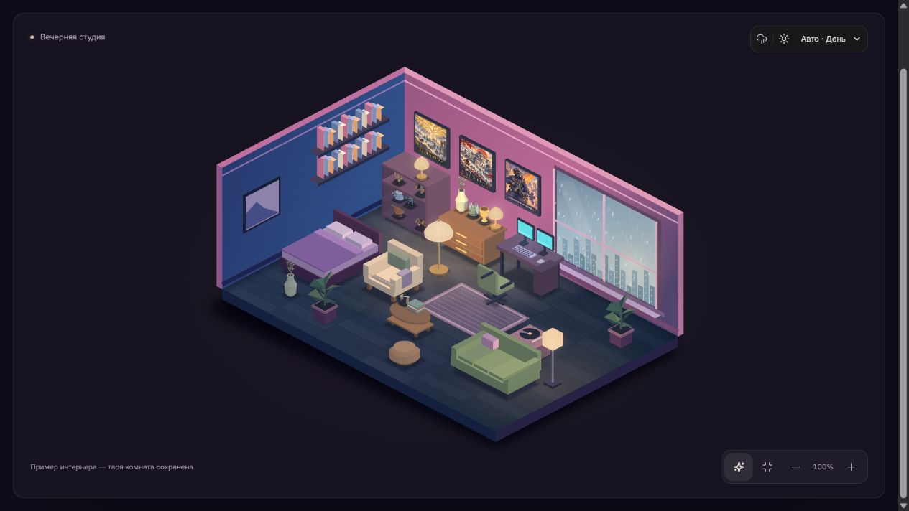

<div align="center">

# myroom.

### Твоя комната. Твоя музыка. Твой тихий вечер.

Обустраивай своё пространство, слушай любимые треки<br>
и оставляй суету за окном.

[](https://myroom-tawny.vercel.app/)
[](package.json)

**[Возможности](#возможности)** · **[Атмосфера](#атмосфера-в-одно-нажатие)** · **[Запуск](#локальный-запуск)** · **[Документация](#документация)**

<br>



<sub>Пример обставленного интерьера в приложении</sub>

</div>

<br>

## Маленькое место для себя

**MyRoom** — персональная интерактивная комната с музыкой, погодой за окном и вещами, которые нравятся именно тебе. Переставь диван, поставь растение на полку, выбери тёплый свет и включи любимый плейлист.

Здесь нет RPG, квестов и уровней. За каждую полную минуту запущенного таймера начисляется **1 монета** на новые вещи — без суточного лимита.

## Возможности

| Обустрой пространство | Создай настроение | Включи свою музыку |
| :--- | :--- | :--- |
| Перетаскивание и поворот мебели | День, вечер, ночь и автоматический режим | Загрузка MP3 и WAV |
| Цвета стен, пола и предметов | Четыре времени года | Собственные плейлисты |
| Декор на столах, комодах и полках | Дождь, гроза, снег и зимний ветер | Перемотка, громкость, shuffle и repeat |
| Инвентарь, поиск, фильтры и сортировка | Цвет и яркость гирлянды и подсветки стола | Фоновое воспроизведение |
| Избранное и количество своих вещей в магазине | Постоянный свет, переливание и мерцание | Статистика и история прослушиваний |

### Комната, в которой есть жизнь

- **Житель комнаты** гуляет, работает за компьютером, читает, поливает растения и отдыхает. Можно выбрать занятия, одежду, причёску и аксессуары.
- **Настоящее время** на настенных часах, пар над кружкой и эквалайзер на мониторах. Его 24 частотные полосы реагируют на воспроизводимую музыку.
- **Предметы реагируют на действия:** нажми на лампу, чтобы переключить свет; удерживай мебель мышью, чтобы переместить её.
- **Вещи остаются твоими:** убери предмет в «Мои вещи» и поставь обратно позже. Несколько экземпляров позволяют собрать симметричную композицию или заполнить полки.
- **Режим отдыха** оставляет комнату, компактный плеер и доступ к атмосфере. Вернуться можно кнопкой или клавишей `Esc`.

### Музыка без лишних действий

«Моя коллекция» объединяет загруженные файлы. Добавляй их в плейлисты без копирования; при загрузке из открытого плейлиста треки сразу попадают и в него. Повторная загрузка одинакового файла блокируется по содержимому, даже если изменить его название.

На странице статистики — время прослушивания, сравнение периодов, календарь активности, любимые треки и дослушивания. Музыка продолжает играть при переключении вкладок и программ, пока браузер позволяет странице работать в фоне.

## Атмосфера в одно нажатие

| Пресет | За окном | В комнате | Фоновый звук |
| :--- | :--- | :--- | :--- |
| **Тихий вечер** | Летний закат | Тёплая гирлянда | Тишина |
| **Дождливая ночь** | Осенний дождь | Лавандовый свет | Тихий дождь без грома |
| **Зимний уют** | Снегопад | Золотистый мерцающий свет | Зимний ветер |

Каждый пресет можно настроить под себя. Музыка, дождь, гром и ветер управляются отдельно. Гирлянду можно снять и вернуть, сохранив её цвет, яркость и режим.

## Игровая коллекция

Постеры, фигурки и небольшие детали для тех, кто любит **Elden Ring**, **Sekiro** и **Counter-Strike 2**.

<table>
  <tr>
    <td align="center" width="33%">
      <br>
      <b>Elden Ring</b><br><sub>Древо Эрд · Маления · Ранни · Александр</sub>
    </td>
    <td align="center" width="33%">
      <br>
      <b>Sekiro</b><br><sub>Асина · Волк · идол · катана</sub>
    </td>
    <td align="center" width="33%">
      <br>
      <b>Counter-Strike 2</b><br><sub>Dust II · агент CT · трофей · гарнитура</sub>
    </td>
  </tr>
</table>

<sub>Неофициальный фан-арт. Названия игр и персонажей принадлежат их правообладателям. Происхождение иллюстраций описано в документации ниже.</sub>

## Локальный запуск

Понадобятся **Node.js 24**, npm и доступ к приватному репозиторию.

```sh
git clone https://github.com/yessensiv/myroom.git
cd myroom
npm ci
npm run dev
```

Открой **[127.0.0.1:3000](http://127.0.0.1:3000)**. Гостевой режим работает без подключения облака. На Windows также доступен [файл запуска](Запустить%20MyRoom.cmd).

1. Взаимодействуй с комнатой, чтобы запустить таймер.
2. Открой «Обустроить» и расставь мебель.
3. Выбери атмосферу, загрузи музыку и нажми Play.
4. Перейди в режим отдыха.

> Браузер может требовать нажатие перед воспроизведением звука. Закрытие страницы, сон устройства и ограничения фоновой работы могут остановить музыку и учёт времени.

<details>
<summary><b>Подключение облачного режима</b></summary>

Скопируй [.env.example](.env.example) в `.env.local` и заполни публичные параметры своего проекта:

```dotenv
NEXT_PUBLIC_SUPABASE_URL=
NEXT_PUBLIC_SUPABASE_ANON_KEY=
```

Подготовь базу, функцию музыкальной библиотеки и разрешённые адреса возврата после входа по [руководству настройки](docs/SETUP.md). После изменения переменных перезапусти приложение.

Привилегированные серверные ключи нельзя помещать в переменные `NEXT_PUBLIC_*`.

</details>

## Профиль и регистрация

По главной ссылке открывается презентация приложения. Кнопки входа и регистрации ведут к форме авторизации; сама комната загружается после входа. На главной не запускаются музыка и таймер. Кнопка Google становится доступной после включения провайдера в Supabase.

Кнопка профиля в шапке открывает вход и регистрацию по почте и паролю. Можно выбрать имя и цвет аватара, изменить их после входа, посмотреть свои монеты, вещи и время в комнате. Доступны вход по ссылке и восстановление пароля через письмо.

Для подтверждения регистрации и восстановления на опубликованном сайте нужно настроить разрешённые адреса возврата и доставку писем в Supabase. Гостевой прогресс автоматически в аккаунт не переносится.

## Данные и сохранение

| Данные | Гостевой режим | После входа в аккаунт |
| :--- | :--- | :--- |
| Комната, предметы и монеты | localStorage | PostgreSQL |
| Загруженная музыка | IndexedDB | Приватный Supabase Storage |
| Плейлисты | Браузер | PostgreSQL |
| Музыкальная статистика и настройки плеера | Браузер | Браузер |

**Данные привязаны к адресу сайта и браузеру.** Комната и музыка с `localhost` автоматически не появляются на Vercel. Гостевые данные также не переносятся в аккаунт автоматически.

Таймер можно приостановить и продолжить. Он учитывает фоновые интервалы, но пропускает промежутки без подтверждения дольше 90 секунд. В облачном режиме начисления подтверждает сервер; локальный гостевой баланс предназначен для знакомства с приложением.

## Под капотом

| Слой | Технологии |
| :--- | :--- |
| Интерфейс | Next.js 16 · React 19 · TypeScript · Lucide |
| Изометрическая сцена | PixiJS 8 · Canvas 2D |
| Музыка и анализ звука | HTMLAudio · Web Audio API |
| Локальное хранение | localStorage · IndexedDB |
| Облачное хранение и вход | Supabase Auth · PostgreSQL · Storage · Edge Functions |
| Развёртывание | Vercel · GitHub |

Комната использует **2.5D-изометрию**, программную отрисовку предметов и освещения. Плавность зависит от устройства и наполнения сцены; поддерживаются пауза анимации и системное уменьшение движения.

<details>
<summary><b>Структура проекта и команды</b></summary>

```text
src/
├── app/           Страница приложения и стили
├── components/    Комната, плеер, панели и уведомления
├── domain/        Каталог, экономика и правила размещения
├── engine/        Изометрия, свет и графика
└── lib/           Состояние, сохранение и аудио
public/            Иллюстрации, музыка и звуки
supabase/          Миграции и облачные функции
tests/             Модульные тесты и SQL-сценарии
docs/              Настройка, скриншоты и история разработки
```

| Команда | Назначение |
| :--- | :--- |
| `npm run dev` | Локальная разработка |
| `npm run typecheck` | Проверка TypeScript |
| `npm test` | Модульные тесты |
| `npm run build` | Сборка приложения |
| `npm start` | Запуск собранной версии |

SQL-сценарии из `tests/*.sql` запускаются отдельно в тестовой базе и не входят в `npm test`.

</details>

## Статус проекта

**Рабочая версия в развитии**, размещённая на [Vercel](https://myroom-tawny.vercel.app/). Доступна одна комната с редактором, музыкальной библиотекой и магазином.

Остаётся доработать перенос гостевых данных, долговечную очередь офлайн-изменений и обновление истёкших ссылок на длинные облачные треки. Доставку писем входа и работу под нагрузкой нужно проверять отдельно. Подробности — в [настройке облачного режима](docs/SETUP.md).

## Документация

- [Подключение облака и ограничения](docs/SETUP.md)
- [Дизайн-система](UI-DESIGN-SYSTEM.md)
- [История разработки](docs/DEVELOPMENT-HISTORY.md)
- [Происхождение постеров](public/art/posters/ART-NOTES.md)
- [Авторы и лицензии звуков](public/audio/CREDITS.txt)

---

<div align="center">

**Поставь любимую пластинку. Найди место для новой вещи. Останься на минуту.**

[Открыть свою комнату →](https://myroom-tawny.vercel.app/)

</div>
